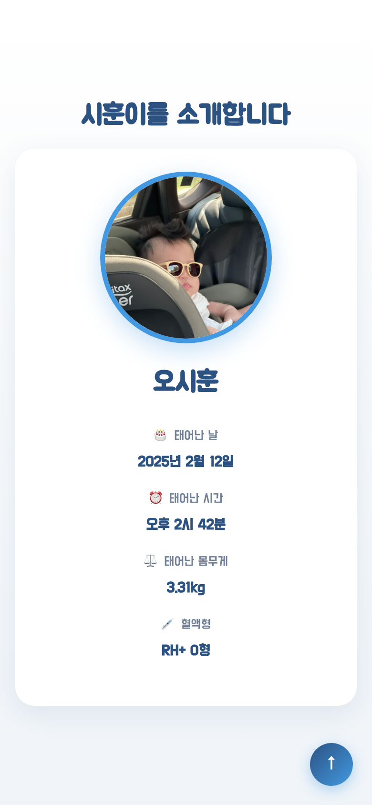
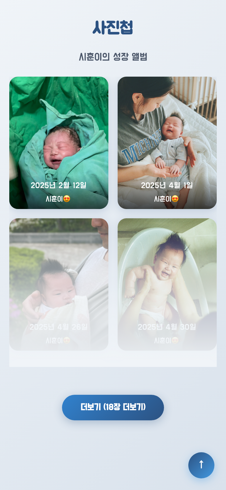
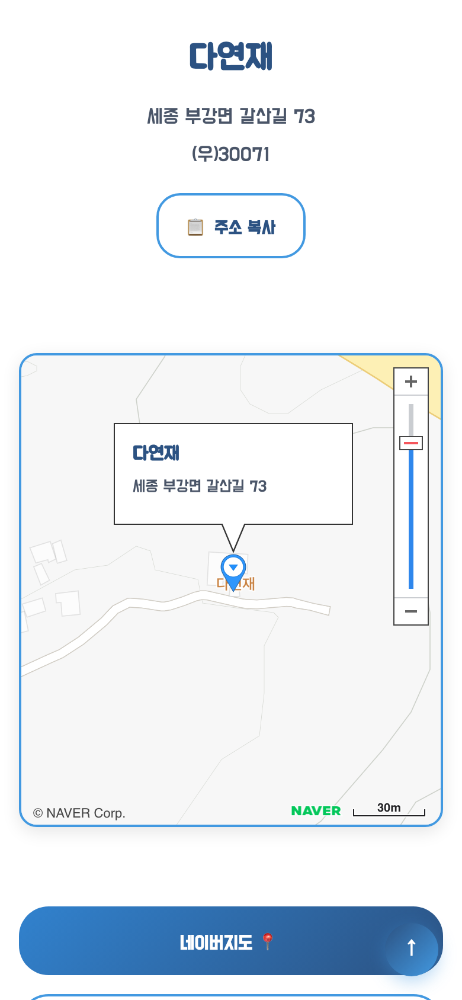
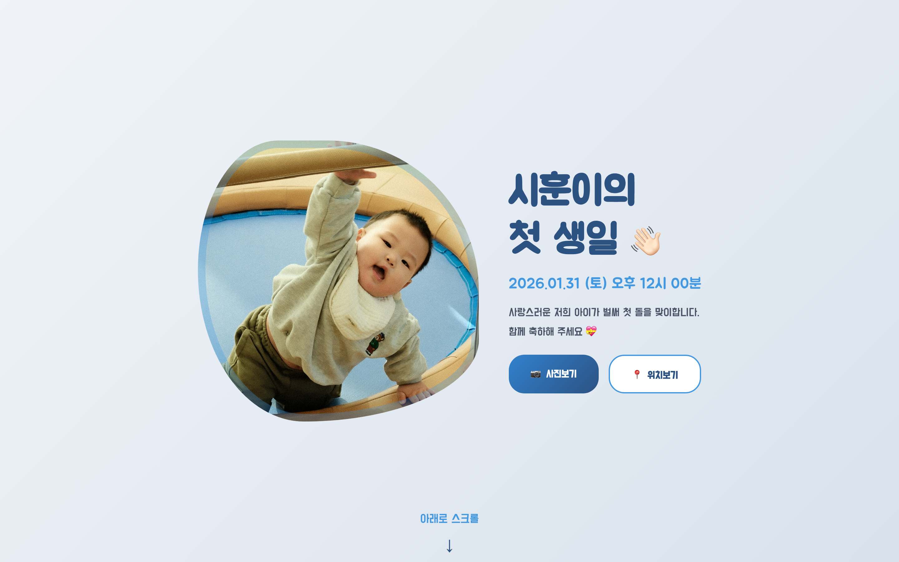

<div align="center">

# 🎂 시훈이의 첫 생일 초대장

**2026.01.31 · 세종 다연재 · 기념 보존본**

시훈이의 첫 돌잔치에 손님을 모셨던 모바일 초대장입니다.<br>
행사는 끝났고, 지금은 가족의 기념으로 그대로 보존하고 있습니다.

<br>

[](https://react.dev/)
[](https://vite.dev/)
[](https://dongyeopoh.github.io/ohsihun-1st-HBD/)
[](#manage)

**[🌐 사이트 보기](https://dongyeopoh.github.io/ohsihun-1st-HBD/)** &nbsp;·&nbsp;
**[✨ 구성](#features)** &nbsp;·&nbsp;
**[📱 화면](#screens)** &nbsp;·&nbsp;
**[🛠 관리 정보](#manage)**

<br>


</div>

<br>

<a id="features"></a>

## ✨ 구성

한 페이지를 위에서 아래로 내려가며 보는 초대장입니다. 휴대폰·태블릿·데스크탑 화면 크기에 맞춰 배치가 바뀝니다.

| | 섹션 | 내용 |
|:-:|---|---|
| 🏠 | **첫 화면** | 대표 사진과 제목, 행사 일시, 축하 문구가 차례로 나타나는 등장 애니메이션. '사진보기'·'위치보기' 버튼으로 바로 이동 |
| 👶 | **소개** | 프로필 사진과 함께 시훈이를 소개 |
| 📸 | **사진첩** | 태어난 날부터 첫 돌을 앞둔 때까지 24장. 화면에 들어올 때 불러오고, 사진 속 촬영 일시를 읽어 날짜 캡션을 자동으로 표시. 더보기·접기, 눌러서 크게 보기 |
| 🗺️ | **오시는 길** | 네이버 지도, 주소 복사, 네이버·카카오 지도 바로가기, 주차 안내 |
| ⬆️ | **공통** | 조금 내려가면 나타나는 '맨 위로' 버튼 |

<a id="screens"></a>

## 📱 화면

<table>
  <tr>
    <td align="center"></td>
    <td align="center"></td>
    <td align="center"></td>
    <td align="center"></td>
  </tr>
  <tr>
    <td align="center"><sub><b>첫 화면</b></sub></td>
    <td align="center"><sub><b>소개</b></sub></td>
    <td align="center"><sub><b>사진첩</b></sub></td>
    <td align="center"><sub><b>오시는 길</b></sub></td>
  </tr>
</table>

<p align="center">
  <br>
  <sub><b>데스크탑 첫 화면</b></sub>
</p>

<a id="manage"></a>

## 🛠 관리 정보

<details>
<summary><b>📸 사진 규칙</b></summary>
<br>

- 파일: `public/images/SIHUN_1.jpg` ~ `SIHUN_24.jpg` (촬영일 순, 빈 번호 없이), 주차 안내 `parking.jpg`
- 첫 화면 사진은 `SIHUN_23` (`src/components/Home.css`), 소개 사진은 `SIHUN_12` (`src/components/Intro.jsx`), 공유 미리보기 이미지는 `SIHUN_6` (`index.html`)
- 사진 수를 바꾸면 `src/components/Photo.jsx`의 `PHOTO_COUNT`를 같이 맞춥니다. 처음 보이는 장수는 `INITIAL_DISPLAY`(6)입니다.
- 날짜 캡션은 사진 파일의 EXIF 촬영 일시로 만들어지므로, 메타데이터가 지워진 사진에는 캡션이 생기지 않습니다.
- 사진은 원본 그대로 둡니다. 압축·회전·메타데이터 삭제 같은 가공을 하지 않습니다.
- 대표 사진이나 사진첩 처음 6장이 바뀌면 `docs/screenshots/`의 화면 캡처도 다시 찍습니다.

</details>

<details>
<summary><b>📍 정보 위치</b></summary>
<br>

- 첫 화면 문구·일시: `src/components/Home.jsx`
- 아이 소개: `src/components/Intro.jsx`의 `babyInfo`
- 장소·좌표·지도 링크: `src/components/Location.jsx`의 `locationInfo`
- 공유 미리보기(제목·이미지): `index.html`

</details>

<details>
<summary><b>💻 개발</b></summary>
<br>

```bash
npm ci
npm run dev      # http://localhost:5173/ohsihun-1st-HBD/
npm run lint
npm run build
```

</details>

<details>
<summary><b>🚀 배포 (GitHub Pages)</b></summary>
<br>

```bash
npm run build
git add -f dist
git add -A
git commit -m "변경 내용"
git push origin main
git subtree push --prefix dist origin gh-pages
```

</details>

<details>
<summary><b>🧰 기술 스택</b></summary>
<br>

React 19, Vite 7, Framer Motion, exifr, CSS

</details>

<details>
<summary><b>📚 관리 문서</b></summary>
<br>

| 문서 | 내용 |
|---|---|
| [`CLAUDE.md`](CLAUDE.md) | 프로젝트 개요와 반드시 지킬 것 |
| [`docs/architecture.md`](docs/architecture.md) | 화면 구성, 외부 서비스, 배포 구조 |
| [`docs/business-rules.md`](docs/business-rules.md) | 고정된 행사·아이 정보, 사진첩·지도·첫 화면 동작 규칙 |
| [`docs/security.md`](docs/security.md) | 개인정보 공개 범위, 사진 메타데이터, 지도 키 |
| [`docs/standards.md`](docs/standards.md) | 완료 기준, 경로·코드·git 규칙 |
| [`docs/engineering-notes.md`](docs/engineering-notes.md) | 자주 겪는 문제와 사진 교체 절차 |
| [`docs/operations.md`](docs/operations.md) | 설치·개발·검증·배포·되돌리기 |
| [`docs/contracts.md`](docs/contracts.md) | 공개 주소, 공유 미리보기, 외부 API 호출 형식 |

</details>
